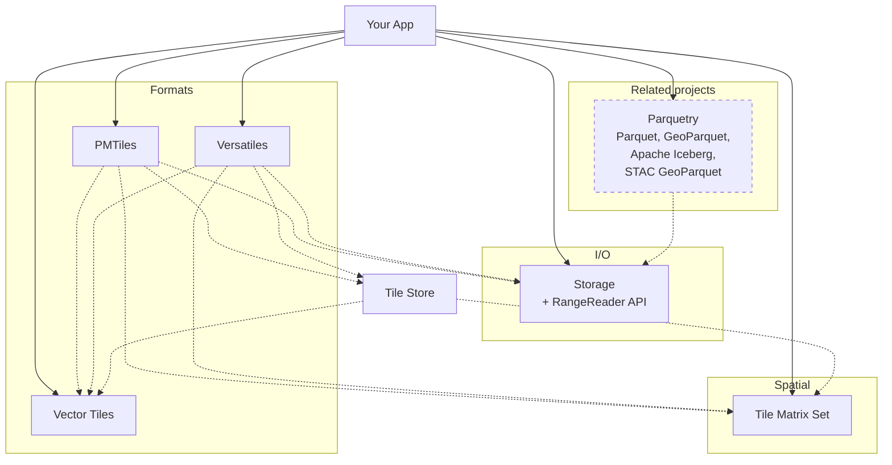
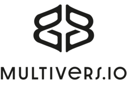

# Tileverse

**Java libraries for cloud-native geospatial applications.**

[](https://central.sonatype.com/search?q=io.tileverse)
[](https://github.com/tileverse-io/tileverse/actions)
[](LICENSE)
[](https://openjdk.org/)

Tileverse is a set of Java libraries for cloud-native geospatial applications. Each library solves one problem: object storage, tile archives, vector tile encoding, or tile grids. Use the ones you need, alone or together.

The documentation is at [tileverse.io](https://tileverse.io/), and the API reference at [javadoc.io](https://javadoc.io/doc/io.tileverse).

## Libraries

| Library | Artifact | Use it to |
| :--- | :--- | :--- |
| **[Storage](https://tileverse.io/storage/)** | `tileverse-storage-all` | List, read, write and presign objects on local disks, HTTP, S3, Azure and GCS through one API, and read byte ranges of single files. |
| **[PMTiles](https://tileverse.io/pmtiles/)** | `tileverse-pmtiles` | Read PMTiles archives, as tile bytes or as decoded vector and raster tiles. |
| **[Versatiles](https://tileverse.io/versatiles/)** | `tileverse-versatiles` | Read VersaTiles containers, as tile bytes or as decoded vector and raster tiles. |
| **[Vector Tiles](https://tileverse.io/vectortiles/)** | `tileverse-vectortiles` | Encode and decode Mapbox Vector Tiles with JTS geometries. |
| **[Tile Matrix Set](https://tileverse.io/tilematrixset/)** | `tileverse-tilematrixset` | Map coordinates to tiles with the OGC Tile Matrix Set model. |
| **[Tile Store](https://tileverse.io/pmtiles/reference/tile-stores/)** | `tileverse-tilestore` | Read tiles through one API, whatever the archive format. |

## How they fit together

The archive readers build on the other libraries. Storage, Vector Tiles and Tile Matrix Set are independent of each other. Parquetry, a separate project, reads object storage through Storage.



## Add the dependency

Tileverse is published on Maven Central. Import the BOM, then declare the modules you need:

```xml
<dependencyManagement>
  <dependencies>
    <dependency>
      <groupId>io.tileverse</groupId>
      <artifactId>tileverse-bom</artifactId>
      <version>2.1.2</version>
      <type>pom</type>
      <scope>import</scope>
    </dependency>
  </dependencies>
</dependencyManagement>

<dependencies>
  <dependency>
    <groupId>io.tileverse.storage</groupId>
    <artifactId>tileverse-storage-all</artifactId>
  </dependency>
</dependencies>
```

[Getting Started](https://tileverse.io/getting-started/) shows the Gradle setup and the BOM of third-party versions.

## Related projects

[Parquetry](https://parquetry.io/) reads and writes Apache Parquet and GeoParquet files from Java. Its experimental modules read Apache Iceberg tables and STAC GeoParquet catalogs. It is a separate project with its own releases.

## Development

This is a Maven project, with a Makefile for the common commands. Building needs **JDK 25** or later. The libraries run on Java 17 or later, and `tileverse-io-ffm` requires Java 25. The integration tests need **Docker**.

```bash
make help      # Show all commands
make           # Build and test everything
make test      # Run unit & integration tests
make format    # Fix code style (Spotless)
```

The [Developer Guide](https://tileverse.io/developer-guide/) covers building, testing and contributing.

## Supporters

This project is made possible through the collaboration and support of the following organizations and individuals.

A **supporter** is anyone who contributes to the project in any way, through code, ideas, time, or funding, while a **sponsor** specifically contributes financially. The current sponsors list is maintained in [SPONSORS.md](SPONSORS.md).

### Organizations

[](https://www.multivers.io/)

### Individuals

The complete list of individual supporters, including repository contributors and other supporters, is maintained in [SUPPORTERS.md](SUPPORTERS.md).

## License

Released under the [Apache License 2.0](LICENSE).

Copyright &copy; 2025 Multiversio LLC.
