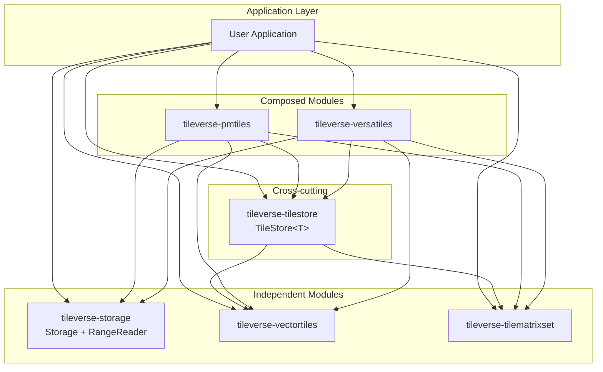

# Architecture

Tileverse is a set of loosely coupled libraries. Each module works on its own, for one domain: I/O, tile grids, or tile encodings.

## Module map

The Tileverse monorepo ships six library modules and a BOM. Three are independent of each other: `tileverse-storage`, `tileverse-vectortiles` and `tileverse-tilematrixset`. `tileverse-tilestore` builds on the format and grid libraries. The archive readers `tileverse-pmtiles` and `tileverse-versatiles` depend on all the others (`tileverse-storage` for I/O, `tileverse-vectortiles` for MVT decoding, `tileverse-tilematrixset` for grid math, `tileverse-tilestore` for the high-level tile-store wrappers).

## System context

The Tileverse system sits between consumer applications and five external storage families: local FS, HTTP, S3-compatible object stores, Azure and GCS.

## Container view

The library modules, their dependencies on each other, and their dependencies on the external storage systems. `tileverse-pmtiles` and `tileverse-versatiles` depend on every other Tileverse module; `tileverse-tilestore` brings the format-agnostic `TileStore<T>` abstraction; the four storage containers (`-core`, `-s3`, `-azure`, `-gcs`) compose under `-all` for callers that want every backend at once.

Per-module C4 component views are embedded in each library's section:

- [Storage core internals](../../storage/explanation/internals.md)
- [PMTiles internals](../../pmtiles/index.md#component-view)
- [Versatiles internals](../../versatiles/index.md#component-view)
- [Vector Tiles internals](../../vectortiles/index.md#component-view)
- [Tile Matrix Set internals](../../tilematrixset/index.md#component-view)
- [Tile Stores internals](../../pmtiles/reference/tile-stores.md#component-view)

All C4 diagrams are generated from `docs/structurizr/workspace.dsl` and `docs/structurizr/dynamic-views.dsl` via `docs/build.sh` (Docker required). Edit the DSL and rerun the build to regenerate.

## Design principles

- **I/O stays separate from formats.** A format library, such as a GeoTIFF reader, should not implement its own S3 client. `Storage` provides the container API, and its `RangeReader` the byte-range reads of single files.
- **Grid math needs no GIS library.** `tileverse-tilematrixset` computes tile coordinates and bounding boxes with no GIS or I/O library; it depends on Jackson for its JSON encoding. A tile server can use it whatever its data source.
- **Codecs do no I/O.** `tileverse-vectortiles` converts between the protobuf encoding and JTS geometries.
- **Archive readers compose the rest.** `tileverse-pmtiles` and `tileverse-versatiles` read through a `RangeReader`, use the tile matrix set for the grid, and decode tiles with the vector tile codec or `javax.imageio`.

## Reading a tile

When a `PMTilesReader` reads the tile `(z, x, y)`:

1. It computes the tile id of the tile along the Hilbert curve.
2. It looks the id up in the directories. A directory missing from its cache costs one range request.
3. It reads the tile body with one range request, and removes the tile compression of the archive.
4. A tile store decodes the bytes: `PMTilesVectorTileStore` with `VectorTileCodec`, and `PMTilesRasterTileStore` with `javax.imageio.ImageIO`. The decoder reads from a stream over a pooled buffer holding the tile bytes.

`PMTilesReader` keeps parsed directories in its own cache, and block-aligns its reads of the header, the directories and the metadata. Tile bytes are cached only when the reader passed to `PMTilesReader` is a `CachingRangeReader`.

## Extension points

- Implement `StorageProvider`, registered through `ServiceLoader`, to add a storage backend: for example an internal content-addressed store, a store with its own URI scheme, or a test harness. Native protocols like OpenStack Swift, Azure Files (SMB), or HDFS through WebHDFS are out of scope; see [Why tileverse-storage?](../../storage/explanation/why.md#when-not-to-use-this-library).
- Subclass `AbstractTileStore<T>` to expose a different archive format under the same `TileStore<T>` contract, as `tileverse-versatiles` does for VersaTiles containers. MBTiles would fit the same way.
- Implement `TileMatrixSet` to support non-Earth or custom grids while reusing the rest of the stack unchanged.

## Third-party dependencies

The Module column names the modules declaring each dependency.

| Library | Usage | Module |
| :--- | :--- | :--- |
| **[JTS Topology Suite](https://github.com/locationtech/jts)** | Geometry model (Points, Polygons, etc.) | `vectortiles`, `tilestore` |
| **[Caffeine](https://github.com/ben-manes/caffeine)** | High-performance in-memory caching | `storage-core`, `tilestore`, `pmtiles`, `versatiles` |
| **[Jackson](https://github.com/FasterXML/jackson)** 3 | JSON encodings (OGC TMS, TileJSON, PMTiles and Versatiles metadata) | `tilematrixset`, `tilestore`, `pmtiles`, `versatiles` |
| **[Google Protocol Buffers](https://github.com/protocolbuffers/protobuf)** | MVT binary encoding/decoding | `vectortiles` |
| **[webp-imageio](https://github.com/usefulness/webp-imageio)** | `ImageIO` plugin for WebP-encoded raster tiles (registered via JDK SPI; ships native libs for Linux and macOS on x86_64 and arm64, and for Windows on x86 and x86_64) | `pmtiles`, `versatiles` |
| **[Apache Commons Compress](https://commons.apache.org/proper/commons-compress/)** | Gzip, Zstandard and Brotli decompression of tiles, directories and indexes | `pmtiles`, `versatiles` |
| **[zstd-jni](https://github.com/luben/zstd-jni)** | Native Zstandard codec used by Commons Compress | `pmtiles`, `versatiles` |
| **[Brotli decoder](https://github.com/google/brotli)** | Brotli decoder used by Commons Compress | `pmtiles`, `versatiles` |
| **[SLF4J](https://www.slf4j.org/)** | Logging abstraction | All |

The cloud SDKs come only with the storage module of their backend:

| Library | Usage | Module |
| :--- | :--- | :--- |
| **[AWS SDK for Java v2](https://github.com/aws/aws-sdk-java-v2)** | S3 storage backend | `storage-s3` |
| **[Azure SDK for Java](https://github.com/Azure/azure-sdk-for-java)** | Azure Blob and Data Lake Gen2 storage backend | `storage-azure` |
| **[Google Cloud Java](https://github.com/googleapis/google-cloud-java)** | GCS storage backend | `storage-gcs` |
