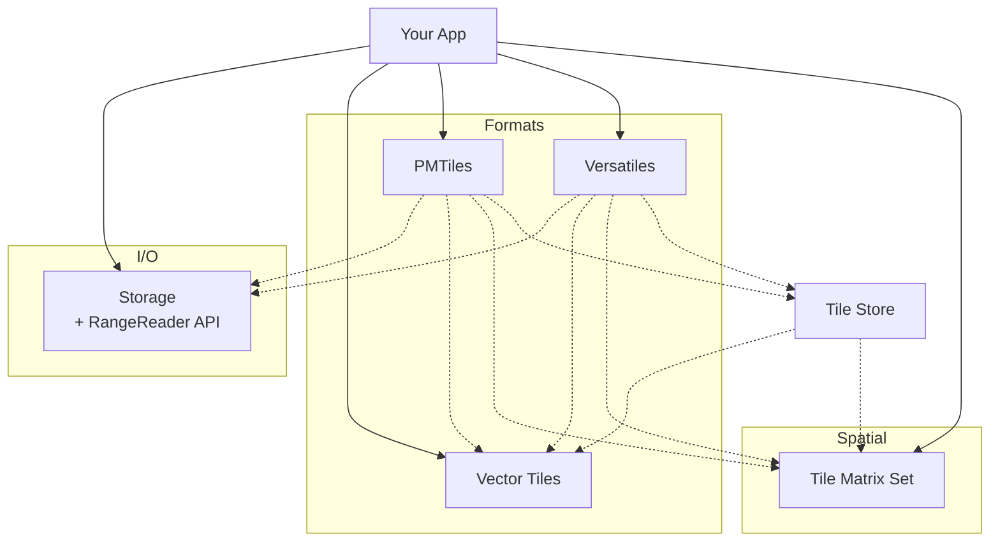

# Tileverse

Tileverse is a set of Java libraries for cloud-native geospatial applications. Each library solves one problem: object storage, tile archives, vector tile encoding, or tile grids. Use the ones you need, alone or together.

## Libraries

| Library | Artifact | Use it to |
| :--- | :--- | :--- |
| **[Storage](storage/index.md)** | `tileverse-storage-all` | List, read, write and presign objects on local disks, HTTP, S3, Azure and GCS through one API, and read byte ranges of single files. |
| **[PMTiles](pmtiles/index.md)** | `tileverse-pmtiles` | Read PMTiles archives, as tile bytes or as decoded vector and raster tiles. |
| **[Versatiles](versatiles/index.md)** | `tileverse-versatiles` | Read VersaTiles containers, as tile bytes or as decoded vector and raster tiles. |
| **[Vector Tiles](vectortiles/index.md)** | `tileverse-vectortiles` | Encode and decode Mapbox Vector Tiles with JTS geometries. |
| **[Tile Matrix Set](tilematrixset/index.md)** | `tileverse-tilematrixset` | Map coordinates to tiles with the OGC Tile Matrix Set model. |
| **[Tile Store](pmtiles/reference/tile-stores.md)** | `tileverse-tilestore` | Read tiles through one API, whatever the archive format. |

[Getting Started](getting-started.md) shows how to add them to a project.

## How they fit together

The archive readers build on the other libraries. **Storage**, **Vector Tiles** and **Tile Matrix Set** are independent of each other:

- Building a GeoParquet datastore that lists and reads partitioned files in S3, Azure or GCS? Use **Storage**.
- Reading Cloud Optimized GeoTIFFs with byte-range requests? Use the `RangeReader` API of **Storage**.
- Building a tile server from PostGIS? Use **Vector Tiles** and **Tile Matrix Set**.
- Need a standard grid definition? Use **Tile Matrix Set**.

